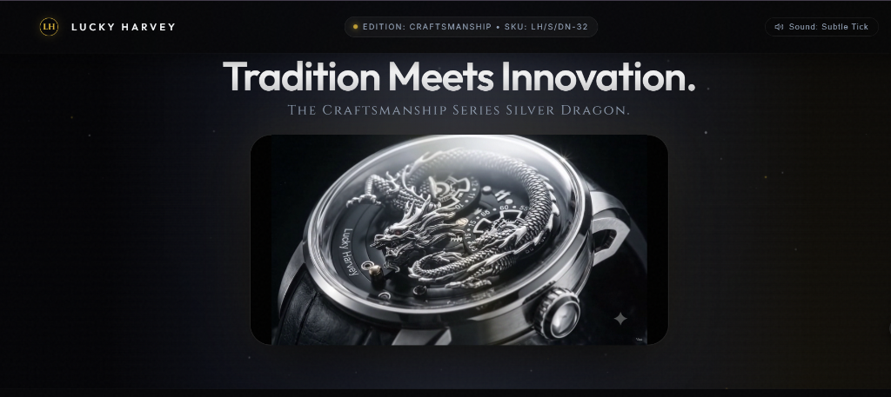
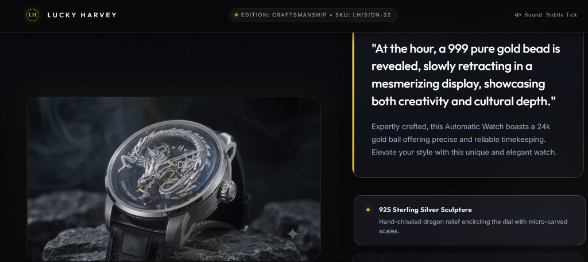
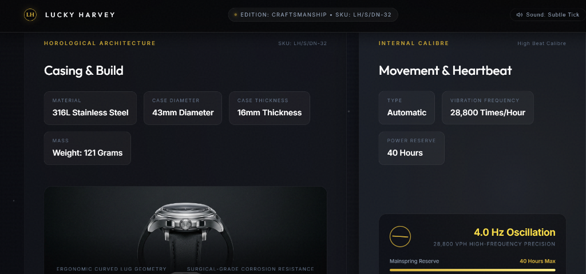

# 🐉 Lucky Harvey — Craftsmanship Series Silver Dragon (LH/S/DN-32)

> **Ultra-Luxury Single-Page Product Launch Showcase**  
> Inspired by Apple’s flagship product presentation aesthetics — high-contrast dark mode, expansive negative space, cinematic canvas animation engines, and bespoke haute horlogerie typography.

🔗 **Live Deployment**: [https://samueljohn369.github.io/lucky-harvey-silver-dragon/](https://samueljohn369.github.io/lucky-harvey-silver-dragon/)

---

## 📸 Visual Previews

### 1. Hero Showcase — 360° Horological Continuous Loop


### 2. Lore & Craftsmanship — Calibre Cinematics Loop


### 3. Technical Specifications — Precision Bento Grid


---

## ✨ Key Features

- **Continuous 360° Horological Orbit (Hero)**:
  - 240-frame pre-rendered image sequence (`assets/herosection/`) rendered on an optimized HTML5 `<canvas>`.
  - Seamless auto-looping animation engine ticking at a cinematic 25 FPS (~40ms per frame) via `requestAnimationFrame`.
  - Progressive batch preloading (20 frames/batch) with instantaneous first-frame render and zero canvas flicker.
  - Zero clutter: completely unconventional luxury statement layout with no intrusive buttons or aggressive CTAs.

- **Calibre Cinematics Loop (Lore & Craftsmanship)**:
  - 300-frame macro mechanical sequence (`assets/secondsection/`) showcasing internal calibre escapement and micro-engraved details in a continuous loop.
  - Asymmetrical editorial layout pairing mythological cultural symbolism with authentic horological details.

- **Celestial Stardust Background Engine**:
  - Pure JavaScript 2D canvas drawing subtle orbital arcs, glowing golden nebulae, and twinkling stardust particles.

- **Ambient Spotlight Cursor Follower**:
  - Smooth inertial cursor-following ambient illumination spotlight adding physical tactile depth.

- **Synthesized Horology Audio FX**:
  - Web Audio API synthesizer recreating an authentic mechanical escapement escapement rhythm (4.0 Hz / 28,800 vph oscillation tick) with an interactive sound toggle.

- **Architectural Bento Grid Specifications**:
  - Interactive micro-tilt 3D perspective hover cards featuring exact dimensions, mass, calibre metrics, and crystal materials.

- **VIP Concierge Acquisition Modal**:
  - Bespoke client enquiry flow generating unique serial allocations (e.g. `LH-DN32-XX/99`) upon request.

---

## 🛠️ Technology Stack

| Layer | Technology | Description |
|---|---|---|
| **Structure** | Semantic HTML5 | Accessible, SEO-optimized markup with clear hierarchy and schema |
| **Styling** | Modern Vanilla CSS3 | Custom design system, CSS custom properties (tokens), Glassmorphism (`backdrop-filter`), Responsive CSS Grid & Flexbox |
| **Typography** | Google Fonts | `Cinzel Decorative` (Haute Display), `Cormorant Garamond` (Editorial Serif), `Plus Jakarta Sans` (Precision Sans) |
| **Animation Engine** | Vanilla JavaScript (ES6+) | `requestAnimationFrame` render loop, Canvas 2D image scaling, batch asset preloader |
| **Audio Synthesis** | Web Audio API | Oscillators and Biquad bandpass filters simulating mechanical watch escapement frequencies |
| **Dependencies** | None (Zero Third-Party Libraries) | 100% dependency-free vanilla architecture for blazing fast load times and clean code |

---

## 📁 Project Structure

```plaintext
Animated Website/
├── assets/
│   ├── herosection/                # 240 PNG frames for 360° watch showcase (001 - 240)
│   ├── secondsection/              # 300 PNG frames for Calibre kinematics loop (001 - 300)
│   ├── images/                     # Studio photographs & macro assets
│   │   ├── case_strap_profile.jpg
│   │   ├── dragon_gold_bead.jpg
│   │   ├── lucky_harvey_dragon_real.jpg
│   │   └── silver_dragon_hero.jpg
│   └── screenshots/                # Showcase preview captures for documentation
│       ├── hero_showcase.png
│       ├── craftsmanship_lore.png
│       └── technical_specs_bento.png
├── scripts/
│   └── main.js                     # Canvas loop engines, audio synth, cursor FX, modal
├── styles/
│   └── main.css                    # Luxury dark design tokens, bento grid, glassmorphism
├── .gitignore                      # Git ignore rules for clean repository
├── index.html                      # Single-page application entry point
└── README.md                       # Project documentation & deployment manual
```

---

## 🚀 Getting Started Locally

Because this project loads sequential image frames over HTTP for canvas rendering, run it using a local HTTP server to avoid browser `file://` CORS restrictions.

### Option 1: Python Built-in Server (Recommended)
```bash
# In the project directory:
python -m http.server 8080
```
Then visit **`http://localhost:8080`** in your browser.

### Option 2: Node.js (npx serve or live-server)
```bash
# Using npx serve:
npx serve .

# Or using Live Server:
npx live-server
```

### Option 3: VS Code Live Server
1. Install the **Live Server** extension in VS Code.
2. Right-click `index.html` and click **"Open with Live Server"**.

---

## 🌐 How to Deploy

### 1. Deploying to GitHub Pages (Easiest)
1. Push this repository to GitHub:
   ```bash
   git init
   git add .
   git commit -m "feat: initial commit of Lucky Harvey luxury animated showcase"
   git branch -M main
   git remote add origin https://github.com/<your-username>/<repo-name>.git
   git push -u origin main
   ```
2. Navigate to your repository on **GitHub.com**.
3. Go to **Settings** → **Pages** (in the left sidebar).
4. Under **Branch**, select `main` and root folder `/ (root)`, then click **Save**.
5. Your website will be live in ~1 minute at `https://<your-username>.github.io/<repo-name>/`.

### 2. Deploying to Vercel
1. Install Vercel CLI or import the repository at [vercel.com](https://vercel.com):
   ```bash
   npm i -g vercel
   vercel
   ```
2. Follow the automated prompts (Zero configuration needed — Vercel detects static HTML/CSS/JS).

### 3. Deploying to Netlify
1. Log into [netlify.com](https://netlify.com).
2. Click **Add new site** → **Import an existing project** → Connect your GitHub repository.
3. Leave build settings blank (publish directory is `.`).
4. Click **Deploy Site**.

---

## ⏱️ Horological Specifications (LH/S/DN-32)

| Specification | Value |
|---|---|
| **Model** | Lucky Harvey Craftsmanship Series Silver Dragon |
| **Reference SKU** | LH/S/DN-32 |
| **Case Material** | 316L Surgical Grade Stainless Steel |
| **Case Diameter** | 43 mm |
| **Case Thickness** | 16 mm |
| **Total Weight** | 121 grams |
| **Sculpture Medium** | Hand-engraved 925 Sterling Silver Dragon |
| **Hourly Complication**| 999 Pure 24K Gold Sphere Revelation Mechanism |
| **Movement Type** | Automatic Mechanical High-Beat Calibre |
| **Oscillation Rate** | 28,800 VPH (4.0 Hz) |
| **Power Reserve** | 40 Hours |
| **Water Resistance** | 50 Meters / 5 ATM |
| **Glass** | Dual Curved Sapphire Crystal with Anti-Reflective Coating |
| **Retail Valuation** | ₹ 205,000 INR |

---

## 📜 License & Credits

- Designed & Developed by **Samuel John** ([@samueljohn369](https://github.com/samueljohn369))
- Inspired by Lucky Harvey Haute Horlogerie & Apple Product Launch Design Language.
- Distributed under the **MIT License**.
